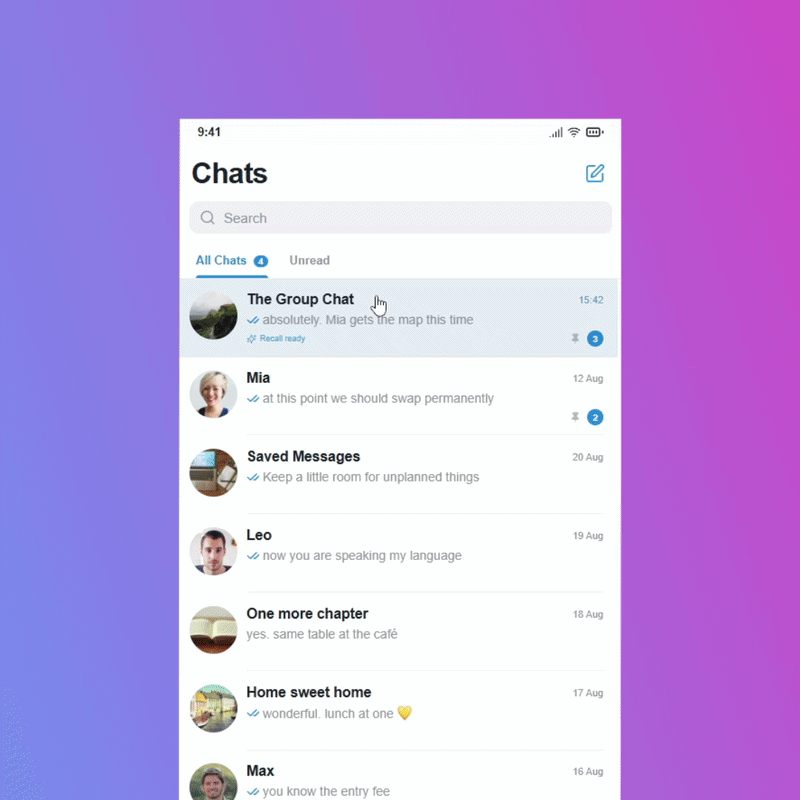
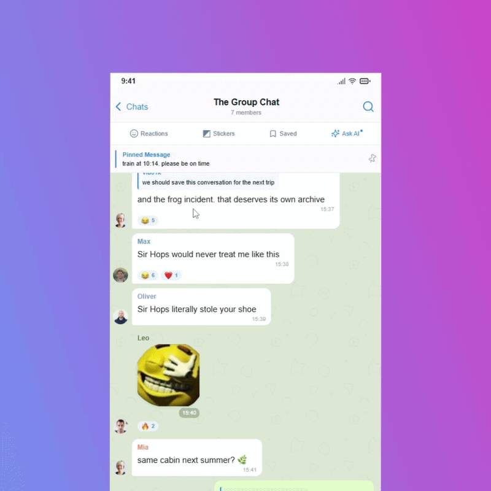
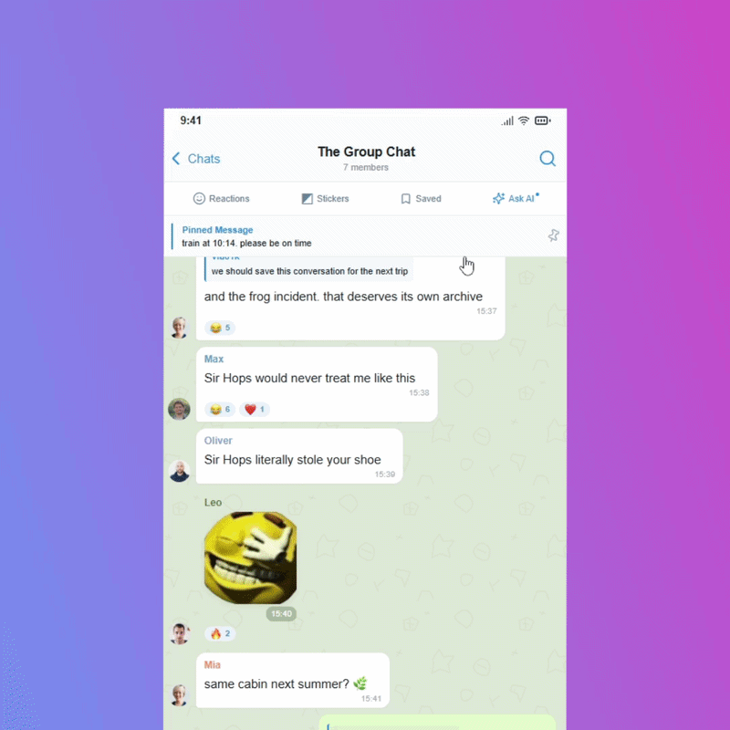
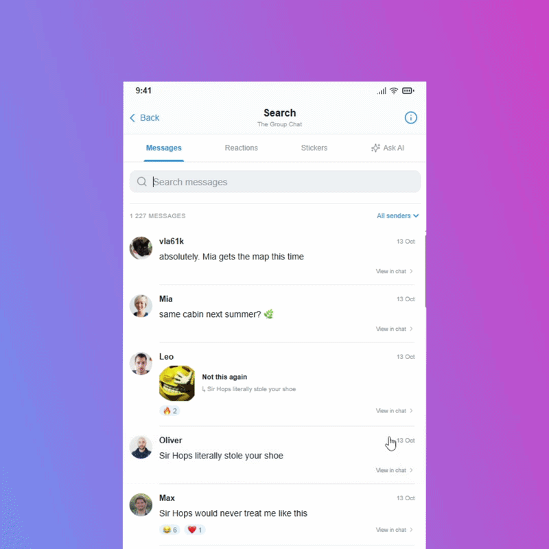

# Telegram Recall

**A concept prototype for smarter chat search, featuring reaction and sticker search, saved conversation fragments, and AI-powered chat insights.**

My chats are full of little moments worth remembering: funny messages, ridiculous jokes, unexpected replies, and sometimes more emotional conversations. We react to these messages with emojis, send stickers, laugh about them, and then move on. Over time, even the most memorable moments get buried under thousands of newer messages. Sometimes I want to revisit something that made us all laugh. Other times, I want to find a conversation that meant a lot to me. But there's a problem: I don't always remember what was said. I remember how we reacted to it. **That's where the idea for Telegram Recall Update started.**

#### Search by Reactions

What if you could search for messages using the reactions they received?

Instead of trying to remember the exact words of a joke, you could simply search for messages with 😂 reactions and rediscover the moments that made everyone laugh.

#### Search by Stickers

In my group chats, certain stickers have become inside jokes. We send them in specific situations, and sometimes just seeing one brings back an entire conversation.

It's a simple way to rediscover the stories behind your favorite stickers.

#### Fragments

Maybe your friends planned something important together. Maybe someone said something you'll want to remember. Or maybe a whole exchange was just too funny to lose.

You can give a Fragment a name, keep it alongside other saved moments, and return to the original messages whenever you want.

#### Your Chat Has Stories to Tell

The idea for this feature actually came from a funny experiment with my friends. One day, a friend of mine uploaded our entire group chat history into Google's NotebookLM. We started asking it all kinds of ridiculous questions about ourselves.

_Where would each of us fall on the political compass?_

_Which character from The Boys would each of us be?_

But AI could be useful for more than just having fun.

*What has my girlfriend been wanting as a gift for ages?*

What made it so entertaining was that the AI wasn't just making up random personality descriptions. It had our conversations as context. What if we could do all of this directly inside Telegram?

AI analysis requires computing resources, so I also imagined integrating it with Telegram Stars.

**I wanted to show not just how these features could look, but how they could actually feel to use inside Telegram.**

**I'd love to hear what you think!**
